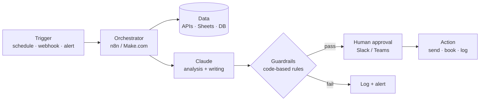

# Robel Teckle

**Founder, Teckle Consulting Group · AI Engineer · DevOps / Systems Administrator · Maryland / DC area**

I build AI agents that do real work for real businesses: sales follow-up, deal finding, trading analysis, and security tooling. I have 10+ years in Linux administration, AWS and DevOps, and I lead technical builds of client-facing AI platforms.

```
Linux (Ubuntu) · AWS · Docker · n8n · Make.com · MCP · Claude API · Git/GitHub · React / React Native · Python · Node.js
```

---

## 🤖 AI agents and projects

Each project has its own page with a plain-English explanation, a diagram, the stack, and setup notes.

| Project | What it does | Stack | Status |
|---|---|---|---|
| [**AI Sales Concierge (Solar)**](projects/ai-sales-concierge.md) | Answers, qualifies and books solar leads around the clock | Claude, n8n, MCP, CRM, Google Sheets | Production build, tech lead |
| [**Solar Sales Follow-up Agent**](projects/solar-sales-agent.md) | Lead follow-up by SMS and AI calls, then books appointments | Make.com, Claude, SMS/voice | In delivery |
| [**DMV Deal & Recovery Agent**](projects/dmv-deal-recovery-agent.md) | Finds distressed DC-area properties and unclaimed funds, drafts outreach | n8n, Claude, DealMachine, Slack | Built, pre-launch |
| [**AI Trading Orchestrator**](projects/ai-trading-orchestrator.md) | Turns TradingView signals into risk-checked trade ideas | TradingView, n8n, Claude, Slack, Sheets | Paper trading |
| [**Kali MCP Server**](projects/kali-mcp-server.md) | Gives Claude Desktop safe access to recon tools in a Kali container | Docker, Kali Linux, Python, MCP | Working |
| [**Mobile Security Lab**](projects/mobile-security-lab.md) | Pocket pentest kit on an Android phone for authorized work | Termux, Debian proot, nmap, tcpdump | Operational |
| [**Lead Finder**](projects/lead-finder.md) | Finds local businesses that have no website | React, n8n/MCP (planned) | Built |
| [**Small-Business Platforms**](projects/small-business-builds.md) | Websites, booking, CRM and mobile apps for small clients | Wix, React Native, n8n | Ongoing |
| [**PhenoAge Calculator**](projects/phenoage-calculator.md) | Biological-age calculator from standard blood markers | Single-file HTML/JS | Done |

## 🧭 How I build agents



Rules I follow on every build:

1. **Code does the math, Claude does the words.** Prices, risk limits and legal checks run in plain code so they are testable.
2. **A human approves anything that leaves the building.** Messages, payments, signatures and trades wait for a click.
3. **Self-hosted where it matters.** n8n runs on my own VPS or in Docker, so client data stays under my control.
4. **Everything is logged.** Each run writes to Sheets or a database so results can be reviewed and measured.

## 🛠️ Skills

- **Infrastructure:** Linux administration, AWS, Docker, VPS hosting, WSL, networking
- **Automation:** n8n, Make.com, webhooks, REST APIs, Google Workspace, Slack, Microsoft Teams
- **AI:** Claude API, Claude Code, MCP servers, prompt design, agent guardrails
- **Security:** authorized penetration testing, network recon, packet capture
- **Field IT:** independent 1099 field-service contracting

## 📫 Contact

**Teckle Consulting Group** is open to AI agent builds, automation, and DevOps work. Reach me through GitHub or LinkedIn.
