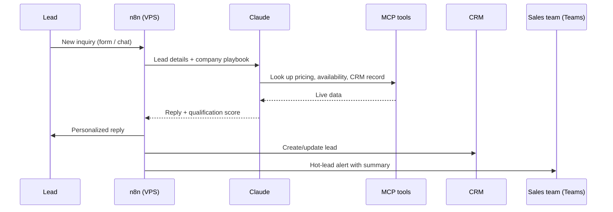

# AI Sales Concierge (Solar)

[← Back to portfolio](../README.md)

**Role:** Technical lead (architecture, pricing, partner documentation)
**Stack:** Claude API · n8n (self-hosted on a VPS) · MCP · CRM integration · Microsoft Teams · Google Sheets

## In plain English

Solar companies lose leads when nobody replies fast enough. This agent replies to every new lead in seconds, answers their questions, works out if they qualify, and hands warm leads to the sales team with notes already written.

## How it works

## Key pieces

| Piece | Job |
|---|---|
| n8n on a VPS | Runs every workflow and keeps data self-hosted |
| Claude | Writes replies and scores the lead |
| MCP | Lets Claude call live tools (CRM lookup, pricing) mid-conversation |
| Google Sheets | Shared data hub for pricing tiers and reporting |
| Microsoft Teams | Where the sales team gets alerts |

## How I use it

- Set the company's playbook (offers, service area, FAQs) once in Sheets.
- The agent handles first contact and qualification.
- Reps only see leads that are ready for a call.

## Setup outline

1. Deploy n8n with Docker on a VPS and put it behind HTTPS.
2. Add Claude API, CRM and Teams credentials in n8n.
3. Import the workflows and point the webhook at the lead form.
4. Fill in the pricing / FAQ sheet.
5. Test with sample leads before turning on live traffic.
