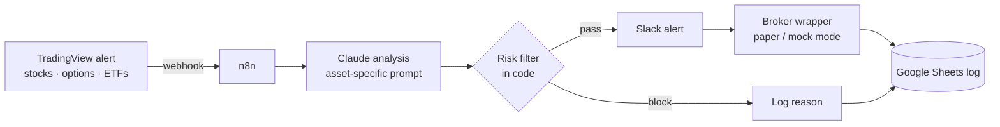

# AI Trading Orchestrator

[← Back to portfolio](../README.md)

**Status:** Orchestrator built and tested; paper trading before any live use
**Stack:** TradingView (Pine Script alerts) · n8n in Docker · Claude API · Slack · Google Sheets · Node.js broker wrapper

> Personal project, not financial advice.

## In plain English

TradingView watches the charts. When a setup appears, it fires an alert. Claude reviews the setup, a code-based risk filter decides whether it is allowed, and the idea lands in Slack with the reasoning. Every decision is logged so the win rate can be measured before real money is involved.

## How it works

## Risk rules (enforced in code, not by the AI)

- Daily loss limit stops all trading for the day
- Small fixed percentage risk per trade, with separate limits for stocks, options and ETFs
- Cap on open positions and on correlated exposure
- Options: minimum days to expiry and a contract cap
- US market hours only

## Rollout plan

1. **Setup:** TradingView alerts, n8n, Claude prompts
2. **Workflow:** wire alerts → Claude → risk filter → Slack → Sheets
3. **Paper trading:** one week minimum; go/no-go based on win rate
4. **Automation:** move to a VPS, start small, scale only on results

## Files in the full build

`TRADING_SYSTEM_ROADMAP.md`, `n8n-workflow-guide.md` (13-node workflow), `claude-trading-prompts.md`, `TRADINGVIEW-ALERT-SETUP.md`, `PRE-FLIGHT-CHECKLIST.md`, `webull-api-wrapper.js`
