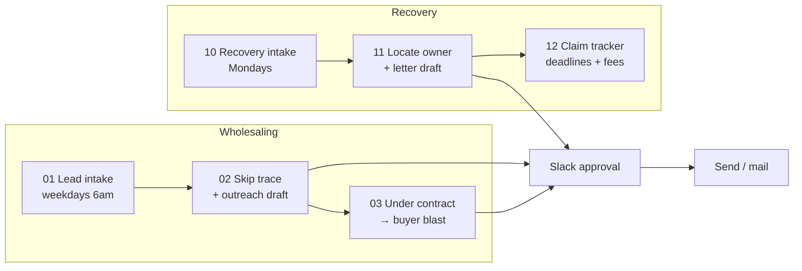

# DMV Deal & Recovery Agent

[← Back to portfolio](../README.md)

**Status:** Built, inactive until launch
**Stack:** Self-hosted n8n · Claude API · DealMachine API · Google Sheets (Postgres planned) · Slack approvals

## In plain English

This agent does two jobs in the DC / Maryland / Northern Virginia area:

1. **Real estate wholesaling.** It finds distressed properties (tax-delinquent, pre-foreclosure, vacant, probate), runs the offer math, and drafts outreach to sellers and cash buyers.
2. **Asset recovery.** It finds money already owed to people, such as tax-sale and foreclosure surplus and unclaimed property, and drafts letters to the owners.

It finds, analyzes and drafts. I approve anything that is sent, signed or paid.

## How it works

| # | Workflow | Trigger | What it does | My step |
|---|---|---|---|---|
| 01 | Lead Intake & Scoring | Weekdays 6am | Searches 12 DMV counties, runs deal math, scores 0–100, posts a Slack digest | Mark leads Approved |
| 02 | Skip Trace & Outreach | Every 30 min | Finds owner contact info, Claude drafts a letter and call opener | Approve, make calls |
| 03 | Buyer Blast | Webhook | Matches cash buyers, Claude drafts the deal announcement | Approve blast |
| 10 | Recovery Intake | Mondays 7am | Pulls surplus and unclaimed lists, checks eligibility and fee rules | Mark cases Approved |
| 11 | Locate & Letter | Hourly | Owner lookup, Claude drafts a letter that discloses the free self-claim option | Approve, mail |
| 12 | Claim Tracker | Weekdays 8am | Tracks deadlines, idle files, fees | Read summary |

## Guardrails

- Deal math and legal checks are plain JavaScript with tests; Claude only writes text.
- Nothing goes out without a Slack approval.
- No SMS. Do-not-call and known litigator numbers are removed.
- State rules are built in (assignment disclosures, licensing thresholds, unclaimed-property fee windows and caps, surplus deadlines).

## Before launch

Attorney review of contracts and letters, a licensed partner where state law requires one, MLS comps access, a cash-buyer list, and public-records requests for surplus data.
