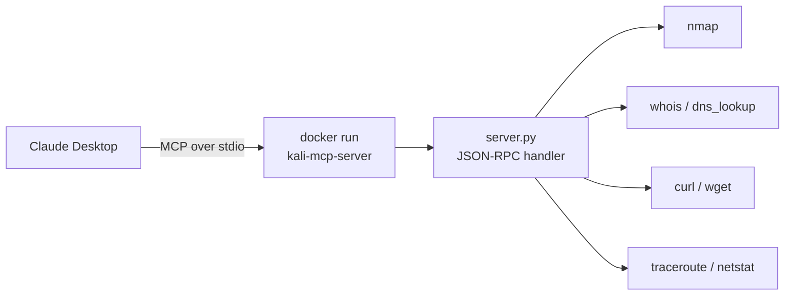

# Kali MCP Server

[← Back to portfolio](../README.md)

**Status:** Working
**Stack:** Docker Desktop · Kali Linux (`kalilinux/kali-rolling`) · Python (stdio MCP server, no dependencies) · Claude Desktop

> For authorized security testing and CTF practice only.

## In plain English

This lets Claude Desktop run network recon tools (nmap, whois, DNS lookups and more) inside an isolated Kali Linux container. Claude asks for a scan, the container runs it, and the results come back into the chat. Nothing runs on the host machine.

## How it works



## Tools exposed

`nmap_scan`, `whois_lookup`, `dns_lookup`, `http_request` (curl/wget), `traceroute`, `netstat`

## Setup

```bash
# 1. Build the image
docker build -t kali-mcp-server:latest .

# 2. Add to Claude Desktop config (claude_desktop_config.json)
```

```json
{
  "mcpServers": {
    "kali": {
      "command": "docker",
      "args": ["run", "-i", "--rm", "kali-mcp-server:latest"]
    }
  }
}
```

3. Restart Claude Desktop and check that the Kali tools appear.

## Lessons learned

- Decorator-based MCP SDK versions kept breaking; a **plain Python stdio server** that handles the JSON protocol directly was the most reliable.
- Kali needs `pip install --break-system-packages`.
- Save the Claude config **without a UTF-8 BOM** or Claude Desktop won't read it.
- Docker cached old builds; `docker system prune -a -f` forced a clean rebuild.
