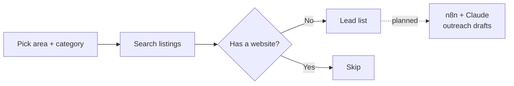

# Lead Finder

[← Back to portfolio](../README.md)

**Status:** Built; n8n / MCP integration planned
**Stack:** React · business listing data · n8n + MCP (planned)

## In plain English

Many local businesses still have no website. Lead Finder searches an area, flags those businesses, and gives a ready-to-contact list for web and automation services.

## How it works

## How I use it

Find local prospects for website and AI-agent builds, then hand the list to an outreach workflow.
