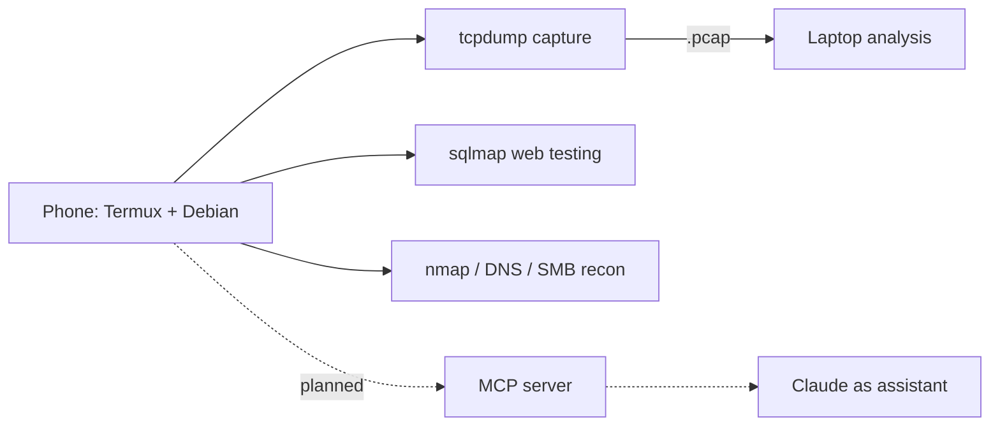

# Mobile Security Lab

[← Back to portfolio](../README.md)

**Status:** Operational, about 10 minutes to activate
**Stack:** Android phone · Termux (F-Droid build) · proot-distro Debian · nmap · tcpdump · sqlmap · hashcat · hydra · enum4linux · dnsutils

> For authorized engagements and CTF practice only.

## In plain English

A full recon toolkit that fits in a pocket. For on-call security work, I can capture traffic and test web apps from a phone, then move the captures to a laptop for deeper analysis.

## How it works

## Design choices

- **Two essentials:** tcpdump and sqlmap. Everything else is a bonus.
- **Skip what doesn't run well on ARM64** (heavy Metasploit, GUI Wireshark, wireless capture).
- **Next step:** an MCP layer so Claude can run scans and summarize results, from the phone or a VPS, for CTF platforms like HackTheBox and TryHackMe.
