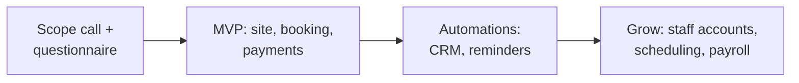

# Small-Business Platforms

[← Back to portfolio](../README.md)

Client builds for small businesses, usually starting simple and adding features as the business grows.

| Build | What I delivered | Stack |
|---|---|---|
| Solar / home-improvement network site | Full site build, mobile navigation fixes, galleries, social share previews | Wix |
| Holistic wellness site | Completed a site build on a fixed package | Wix |
| Cleaning-business platform | Website, instant quotes, booking, CRM, payments; later cleaner accounts, scheduling, payroll | Web + n8n |
| Community social app | Scoping questionnaire, capability plan, React Native build | React Native |

## How I approach these

- Start with what makes money on day one (get found, get booked, get paid).
- Add automation only after the basics run.
- Flag platform risks early, for example app-store review for social apps.
