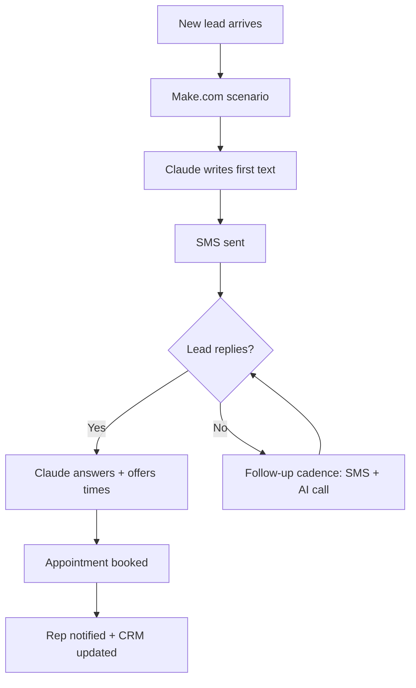

# Solar Sales Follow-up Agent

[← Back to portfolio](../README.md)

**Role:** Developer, building for two solar companies
**Stack:** Make.com · Claude · SMS · AI voice calling · calendar booking

## In plain English

Most solar leads go cold because follow-up stops after one or two tries. This agent keeps following up by text and AI phone call, answers basic questions, and books the appointment on the rep's calendar.

## How it works

## How I use it

- One Make.com build, customized per company (name, offers, calendar).
- Delivered one client at a time: the first company goes live, then the second gets a tuned copy.

## Setup outline

1. Connect lead source, SMS provider, voice provider and calendar in Make.com.
2. Load the company's script and FAQ into the Claude prompt.
3. Set the follow-up cadence (how many touches, how far apart).
4. Run test leads end to end, then switch to live.
